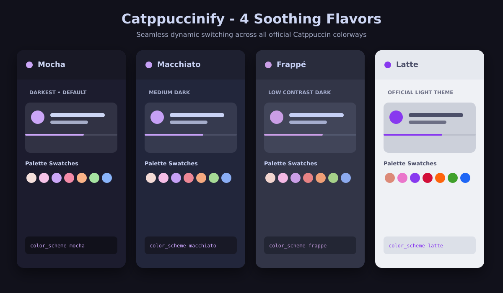
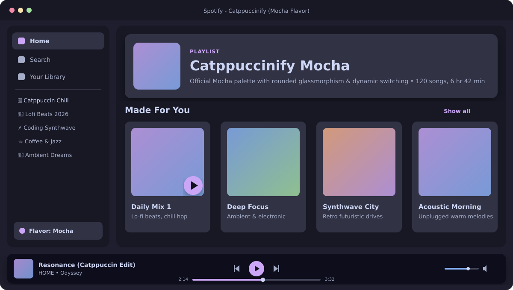
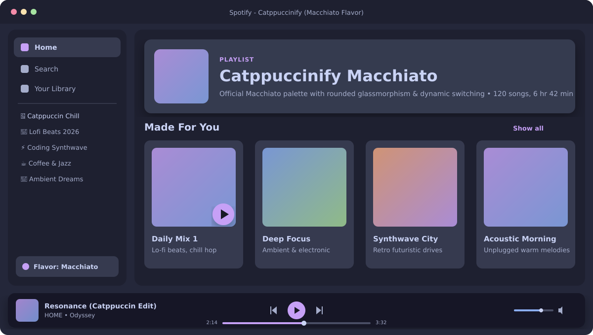
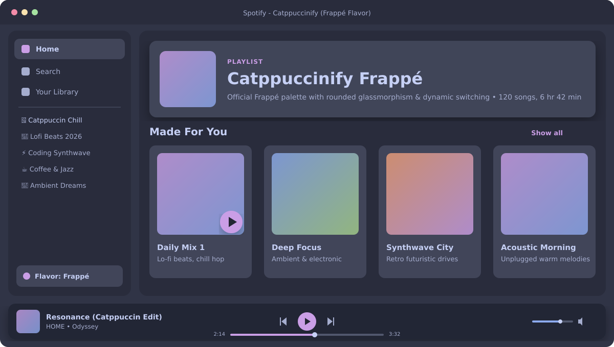
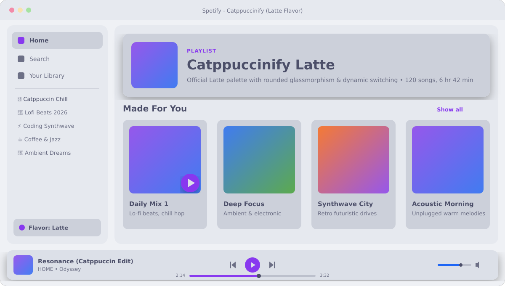

<h1 align="center">
  
  🪴 Catppuccinify for Spicetify 🪴
</h1>

<p align="center">
  <b>Soothing pastel theme for Spotify with official Catppuccin colorways</b><br>
  Featuring <b>Mocha</b>, <b>Macchiato</b>, <b>Frappé</b>, and <b>Latte</b> with dynamic in-app flavor switching.<br>
  <sub>Tested and verified for Spotify versions <b>1.3.6 – 1.3.8</b> (and 1.3.3+)</sub>
</p>

<p align="center">
  <a href="LICENSE.txt">
    
  </a>
  
</p>

---

## 📸 Visual Previews

### 🎨 Flavor Showcase
<p align="center">
  
</p>

<details open>
<summary><b>🔍 Click to view high-resolution previews of each flavor</b></summary>
<br>

#### ☕ Mocha (Darkest / Default)
> Rich dark aesthetic with velvety crust backgrounds and vibrant mauve accents.

<p align="center">
  
</p>

#### 🍫 Macchiato (Medium Dark)
> Balanced, cozy dark theme suited for daytime and evening listening.

<p align="center">
  
</p>

#### 🍧 Frappé (Soft Dark / Low-Contrast)
> Gentle low-contrast dark palette designed to reduce eye strain.

<p align="center">
  
</p>

#### 🥛 Latte (Official Light Palette)
> Crisp, clean light theme with deep lavender, sapphire, and crisp typography.

<p align="center">
  
</p>

</details>

---

## ⚡ Fast One-Liner Installation

Install and apply **Catppuccinify** in a single command using `spicetify` CLI:

### 🐧 Linux & 🍎 macOS
```bash
curl -fsSL https://raw.githubusercontent.com/ddroid/catppuccinify/main/install.sh | bash
```

To install with a specific flavor (e.g. `latte`, `macchiato`, or `frappe`):
```bash
curl -fsSL https://raw.githubusercontent.com/ddroid/catppuccinify/main/install.sh | bash -s -- latte
```

### 🪟 Windows (PowerShell)
```powershell
iwr -useb https://raw.githubusercontent.com/ddroid/catppuccinify/main/install.ps1 | iex
```

Or choose a specific flavor:
```powershell
& ([scriptblock]::Create((iwr -useb https://raw.githubusercontent.com/ddroid/catppuccinify/main/install.ps1))) -Flavor latte
```

---

## 🛠️ Manual Installation (Spicetify CLI)

If you prefer to configure Spicetify manually:

1. **Clone the repository** into your Spicetify Themes folder:
   ```bash
   # Linux & macOS
   git clone --depth 1 https://github.com/ddroid/catppuccinify.git "$(dirname "$(spicetify -c)")/Themes/catppuccinify"

   # Windows (PowerShell)
   git clone --depth 1 https://github.com/ddroid/catppuccinify.git "$(Split-Path (spicetify -c))\Themes\catppuccinify"
   ```

2. **Select theme and flavor** (options: `mocha`, `macchiato`, `frappe`, `latte`):
   ```bash
   spicetify config current_theme catppuccinify color_scheme mocha
   ```

3. **Enable required injection flags and apply**:
   ```bash
   spicetify config inject_css 1 inject_theme_js 1 replace_colors 1 overwrite_assets 1
   spicetify apply
   ```

---

## 🎛️ Dynamic Flavor Switching

Catppuccinify supports switching between flavors in two ways:

### 1. In-App Dynamic Switching (No Terminal Required)
1. Open Spotify.
2. Click the **Catppuccinify Settings** gear icon in the top-right bar (or sidebar).
3. Under **Color Scheme**, pick **Mocha**, **Macchiato**, **Frappé**, **Latte**, or **System** (follows `color.ini`, e.g. DankMaterialShell).
4. The color palette and CSS variables update dynamically in real time and persist across reloads!

### 2. Via Spicetify CLI
```bash
spicetify config color_scheme <mocha | macchiato | frappe | latte>
spicetify apply
```

### 3. System colors (DankMaterialShell / Matugen / any color.ini)
Pick **System (color.ini / DMS)** under **Color Scheme** and Catppuccinify stops forcing a Catppuccin palette: it uses whatever `color.ini` section Spicetify has active, and the cover-art accent snaps to that palette's accents. When the active `color.ini` isn't a Catppuccin one, this mode is chosen automatically. Colors regenerated by `spicetify refresh` are picked up live, without restarting Spotify.

**DankMaterialShell setup** (enable *Run user matugen templates* in DMS):

```bash
THEME_DIR="$(dirname "$(spicetify -c)")/Themes/catppuccinify"
mkdir -p ~/.config/matugen/templates
cp "$THEME_DIR/dms/spicetify-catppuccinify.ini" ~/.config/matugen/templates/
cat >> ~/.config/matugen/config.toml <<TOML

[templates.spicetify]
input_path = '~/.config/matugen/templates/spicetify-catppuccinify.ini'
output_path = '$THEME_DIR/color.ini'
post_hook = 'spicetify refresh -n >/dev/null 2>&1 || true'
TOML
spicetify config current_theme catppuccinify color_scheme Dank
spicetify apply
```

> The generated `color.ini` only contains the `[Dank]` section, so switch the in-app scheme to **System** afterwards (or keep the Catppuccin flavors in a separate theme folder that symlinks `theme.js` / `user.css`).

---

## ✨ Features

- **All 4 Official Catppuccin Palettes**: True-to-spec colors for Mocha, Macchiato, Frappé, and Latte.
- **Dynamic Cover Art Sampling**: In dynamic accent mode, dominant album art colors are snapped to the perceptually nearest Catppuccin swatch with guaranteed text contrast.
- **Modern Rounded Surfaces**: Polished rounded containers, pill tags, and sleek playbars.
- **Lyrics & Extensions**: Built-in support for Liquid Lyrics (including onboarding setup), Beautiful Lyrics, Spicy Lyrics, and Lucid Lyrics.
- **Spotify 1.3.6 – 1.3.8 Ready**: Upstream selector and layout compatibility patches for recent Spotify desktop client releases.
- **Automated CI/CD**: Syntax and asset validation on every commit; automated tagged releases packaging `.zip` distributions.

---

## 🤝 Community & Support

- Original UI design inspired by [Liquify](https://github.com/NMWplays/Liquify) by NMW and [Glassify](https://github.com/sanoojes/spicetify-glassify).
- Catppuccin palette courtesy of the [Catppuccin](https://github.com/catppuccin/catppuccin) project.
- For help or feature requests, open an [issue on GitHub](https://github.com/ddroid/catppuccinify/issues).

---

## 📜 License

This project is licensed under the [GNU Affero General Public License v3.0 (AGPL-3.0)](LICENSE.txt).
